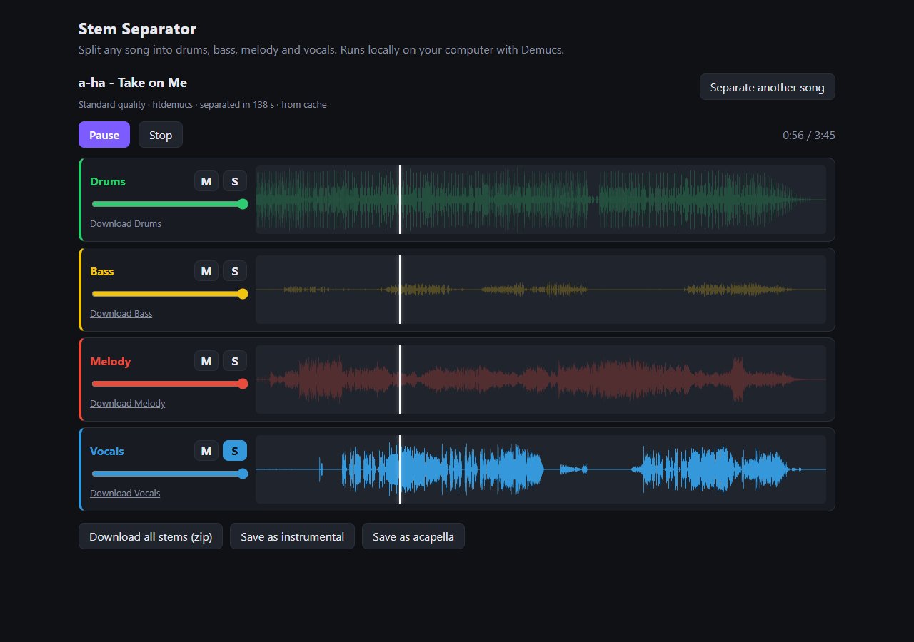

# Stem Separator

Split any song into four stems: **Drums, Bass, Melody and Vocals**.
Listen to each stem in the built-in player, then export single stems, an instrumental or an acapella.

It works like the stem feature in DJ.Studio and uses the same open-source AI model, [Demucs](https://github.com/adefossez/demucs) htdemucs.
Everything runs on your own computer. Your music is never uploaded anywhere, and no GPU is needed.



---

## Quick start

1. Install **Python** and **Node.js** (see [Step 1](#step-1-install-python-and-nodejs)). You only need to do this once.
2. [Download this project](#step-2-download-stem-separator) and unzip it.
3. Double-click **`setup.bat`** and wait for "Setup complete". This also happens only once.
4. Double-click **`run.bat`**. Your browser opens the app.

---

## What you need

| | Minimum |
| --- | --- |
| Operating system | Windows 10 or 11 (64-bit) |
| Memory | 8 GB RAM. 16 GB is recommended for long songs. |
| Disk space | About 3 GB for the app, plus about 160 MB per separated song |
| Internet | Needed for setup and for the first separation, which downloads the AI model |
| Python | 3.10, 3.11, 3.12 or 3.13 |
| Node.js | 18 or newer |

---

## Step 1: Install Python and Node.js

Skip this step if you already have both.

### Option A: one command (Windows 10 and 11)

Open **Start**, type `PowerShell`, open it and paste:

```powershell
winget install Python.Python.3.12
winget install OpenJS.NodeJS.LTS
```

Close the PowerShell window when both finish.

### Option B: installers from the websites

- **Python 3.12:** go to https://www.python.org/downloads/ and run the installer.
  On the first screen, tick **"Add python.exe to PATH"**, then click **Install Now**.
- **Node.js:** go to https://nodejs.org/ and install the **LTS** version with the default options.

## Step 2: Download Stem Separator

Choose one of these:

- **No Git:** on this GitHub page, click the green **Code** button, then **Download ZIP**.
  Right-click the downloaded file, choose **Extract All**, and pick a folder such as `Documents`.
- **With Git:**
  ```powershell
  git clone https://github.com/JLamour28/Stem-separation.git
  ```

## Step 3: Run setup (once)

Open the project folder and double-click **`setup.bat`**.

Setup installs PyTorch, Demucs and the web interface into the project folder.
It downloads about 1 GB, so it can take 5 to 15 minutes. Wait until you see **Setup complete**, then press any key to close the window.

If Windows shows "Windows protected your PC", click **More info**, then **Run anyway**.
This appears because the script isn't signed.

## Step 4: Start the app

Double-click **`run.bat`**. A black window opens and the app appears in your browser at http://127.0.0.1:8000.

Keep the black window open while you use the app. To quit, close it or press **Ctrl+C** in it.

---

## How to use it

1. **Add a song.** Drag an MP3, WAV, FLAC, OGG or M4A file onto the box, or click it to choose a file.
2. **Pick a quality.**
   - **Standard** is recommended. It takes roughly half the song's length on a modern laptop.
   - **High** is slightly cleaner but about four times slower.
3. **Click Separate.** A progress bar shows how far along it is. You can cancel at any time.
   The first separation also downloads the AI model once: about 80 MB for Standard and 320 MB for High.
4. **Listen and mix.** Each stem gets its own coloured lane:

   | Lane | Colour | Contains |
   | --- | --- | --- |
   | Drums | Green | Kick, snare, hats and percussion |
   | Bass | Yellow | Bass line |
   | Melody | Red | Synths, keys, guitars and everything else |
   | Vocals | Blue | Lead and backing vocals |

   - **M** mutes a lane and **S** solos it. You can solo several lanes at once.
   - The slider sets each lane's volume.
   - Click anywhere on a waveform to jump there. The **space bar** plays and pauses.
5. **Export.**
   - **Download** under a lane saves that stem as a WAV file.
   - **Download all stems (zip)** saves all four stems.
   - **Save as instrumental** saves drums, bass and melody mixed together.
   - **Save as acapella** saves the vocals on their own.

Songs you have separated before are remembered. Adding the same file again opens it instantly.

### How long it takes

Measured on an Intel Core i5-1135G7 laptop CPU with 16 GB of RAM:

| Song | Quality | Time |
| --- | --- | --- |
| 3 min 45 s song (MP3) | Standard | 2 min 18 s |
| 15 s clip | Standard | 11 s |
| 15 s clip | High | 47 s |

Faster processors finish sooner.

---

## Troubleshooting

**"Python was not found" or "No supported Python version found"**
Install Python 3.12 as shown in [Step 1](#step-1-install-python-and-nodejs).
Then close the window and run `setup.bat` again.

**"Node.js was not found"**
Install Node.js LTS as shown in [Step 1](#step-1-install-python-and-nodejs), then run `setup.bat` again.

**Setup failed partway through**
This is usually a dropped internet connection. Run `setup.bat` again; it continues where it stopped.
If it keeps failing, delete the `.venv` folder inside the project and run `setup.bat` again.

**"Virtual environment not found" or "Frontend not built" when starting**
Setup has not finished. Run `setup.bat` and wait for "Setup complete".

**The browser says it can't reach the site**
Make sure the black `run.bat` window is still open. Then go to http://127.0.0.1:8000 yourself.

**"Address already in use" or error 10048**
The app is already running in another window. Use that one, or close it and start `run.bat` again.
To use a different port, run this from the project folder:
```powershell
powershell -ExecutionPolicy Bypass -File scripts\run.ps1 -Port 8001
```

**A song fails with "could not read the file"**
Some M4A and AAC files need FFmpeg to decode. Convert the song to MP3 or WAV, or install FFmpeg:
```powershell
winget install Gyan.FFmpeg
```

**My computer gets slow while separating**
Separation uses every CPU core on purpose so it finishes sooner. Use Standard quality, and avoid other heavy programs while it runs.

---

## Freeing disk space and uninstalling

| What | Where | Size |
| --- | --- | --- |
| Separated songs and uploads | the `data` folder in the project | about 160 MB per song |
| AI models | `%USERPROFILE%\.cache\huggingface` | 80 MB to 400 MB |
| Python packages | the `.venv` folder in the project | about 2 GB |

- **To clear your separated songs,** close the app and delete the `data` folder.
- **To uninstall,** delete the project folder and the Hugging Face cache folder above.
  Python and Node.js can be removed from **Settings > Apps** if nothing else uses them.

---

## For developers

### Run in development mode

Start the API with auto-reload in one terminal and the Vite dev server with hot reload in another:

```powershell
.venv\Scripts\python -m uvicorn backend.app:app --reload --port 8000
cd frontend; npm run dev
```

Then open http://localhost:5173. Vite forwards `/api` requests to port 8000.

### Project layout

```
backend/    FastAPI app, job queue, and Demucs wrapper
frontend/   React and TypeScript UI with a Web Audio stem player
scripts/    setup.ps1 and run.ps1, called by setup.bat and run.bat
data/       created at runtime: uploads and separated stems (git-ignored)
```

### API

| Method | Path | Purpose |
| --- | --- | --- |
| POST | `/api/jobs` | Multipart `file` plus `quality` (`standard` or `high`). Returns `job_id`. |
| GET | `/api/jobs/{id}` | Status, progress from 0 to 1, stage and error |
| DELETE | `/api/jobs/{id}` | Cancel a queued or running job |
| GET | `/api/jobs/{id}/stems/{drums,bass,melody,vocals}.wav` | One stem |
| GET | `/api/jobs/{id}/download/{all.zip,instrumental.wav,acapella.wav}` | Exports |
| GET | `/api/health` | Torch version, thread count and loaded models |

Stems are cached in `data/stems/<file hash>-<model>/`, along with `instrumental.wav` and `meta.json`.

### Notes

- PyTorch is pinned to `2.9.1+cpu`, the last release that ships Windows packages for Python 3.10.
- Demucs 4.1.0 decodes audio with `sphn`, so FFmpeg is optional.
- The Demucs model's "other" stem is renamed "melody" to match DJ.Studio.

## Credits

- [Demucs](https://github.com/adefossez/demucs) by Alexandre Défossez and Meta AI Research, MIT licence.
- Stem naming, colours and workflow follow DJ.Studio's public documentation.
  This project is not affiliated with DJ.Studio.
